[LinkedIn](https://linkedin.com/in/devika-ranis) · [Email](mailto:devikaranisanaboyina18@gmail.com) · [GitHub](https://github.com/Devikz)

## About me

I build intelligent systems at the intersection of applied AI, machine learning and data engineering. I'm a Data Science graduate from UMBC with experience in agentic AI, retrieval-augmented generation, analytics and geospatial visualization.

## Engineering by the numbers

| RAG retrieval MRR | Fraud detection ROC-AUC | Purchase records processed | FairSlot automated tests |
| :---: | :---: | :---: | :---: |
| 0.73 → 0.91 | 0.9325 | 45.7M+ | 122 |

## Selected engineering projects

| Project | Focus | Technology |
| --- | --- | --- |
| FraudGuard AI | Financial fraud detection and human-reviewed investigation | PyTorch, FastAPI, RAG |
| AgentShield | LLM safety evaluation and orchestration | LangGraph, MCP, OpenAI |
| FairSlot | Booking, rescheduling and recovery workflows | PostgreSQL, FastAPI, Docker |
| Promotion Effectiveness Analytics | Large-scale retail analytics | BigQuery, dbt |
| Cart Retention Analytics | Behavioral event pipelines and retention analytics | Spark, SQL, dbt |

## Technical ecosystem

**Applied AI:** Agentic systems · RAG · LangGraph · MCP · OpenAI Agents SDK

**Machine learning:** Python · PyTorch · TensorFlow · scikit-learn

**Data engineering:** SQL · BigQuery · Spark · dbt · PostgreSQL

**Application engineering:** FastAPI · Docker · Git · React

**Visualization:** Tableau · Power BI · Folium

## Currently exploring

Reliable agentic systems, AI evaluation, scalable data infrastructure and the intersection of computation and scientific discovery.

---

<i>Building with purpose. Exploring with curiosity.</i>

