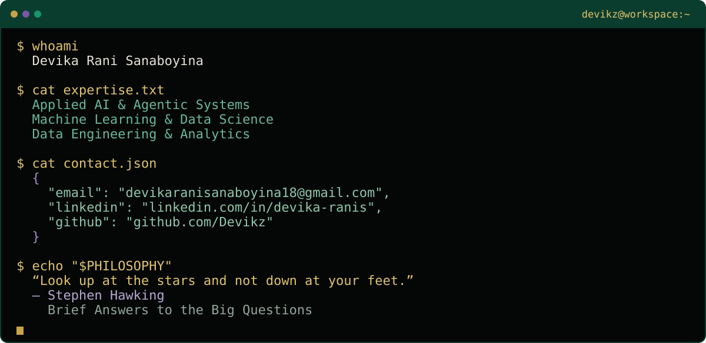
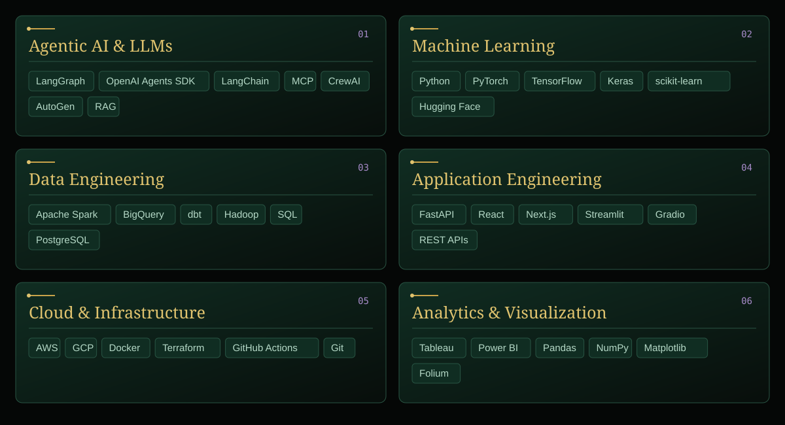
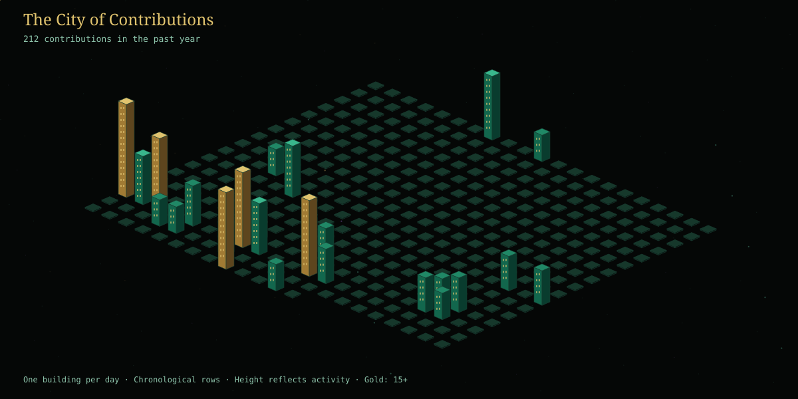

[LinkedIn](https://linkedin.com/in/devika-ranis) · [Email](mailto:devikaranisanaboyina18@gmail.com) · [GitHub](https://github.com/Devikz)

## About me

I build intelligent systems at the intersection of applied AI, machine learning and data engineering. I'm a Data Science graduate from UMBC with experience in agentic AI, retrieval-augmented generation, analytics and geospatial visualization.

## Projects

| Project | Focus | Technology |
| --- | --- | --- |
| FraudGuard AI | Financial fraud detection and human-reviewed investigation | PyTorch, FastAPI, RAG |
| AgentShield | LLM safety evaluation and orchestration | LangGraph, MCP, OpenAI |
| FairSlot | Booking, rescheduling and recovery workflows | PostgreSQL, FastAPI, Docker |
| Promotion Effectiveness Analytics | Large-scale retail analytics | BigQuery, dbt |
| Cart Retention Analytics | Behavioral event pipelines and retention analytics | Spark, SQL, dbt |

## Technical Skills

## The City of Contributions

<!-- The workflow generates the SVG from the actual GitHub contribution calendar. -->

